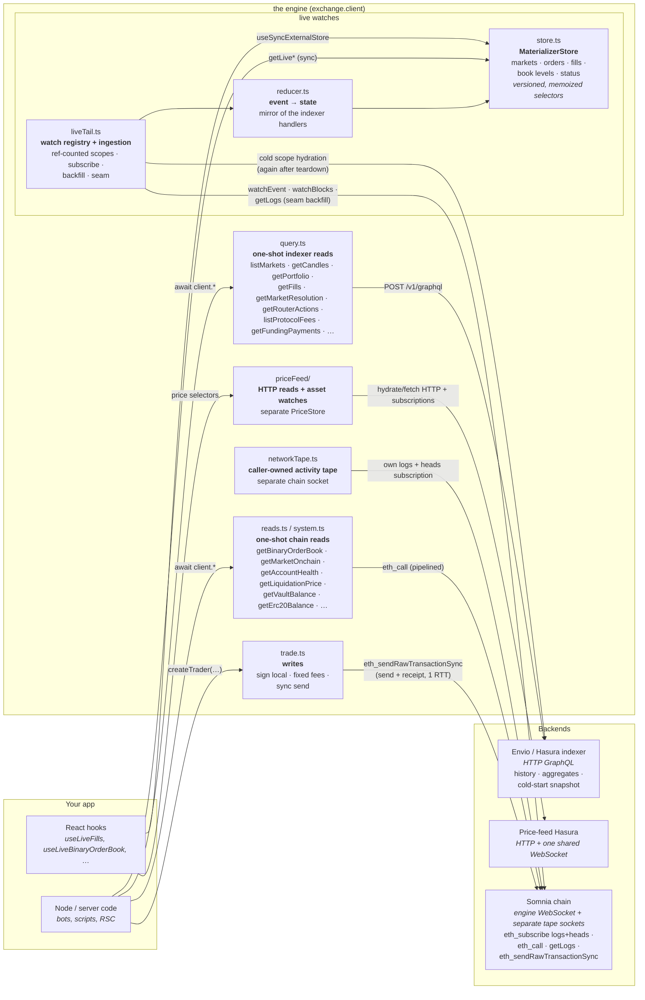
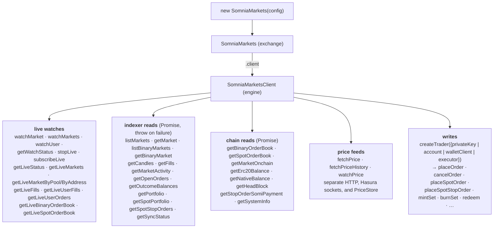
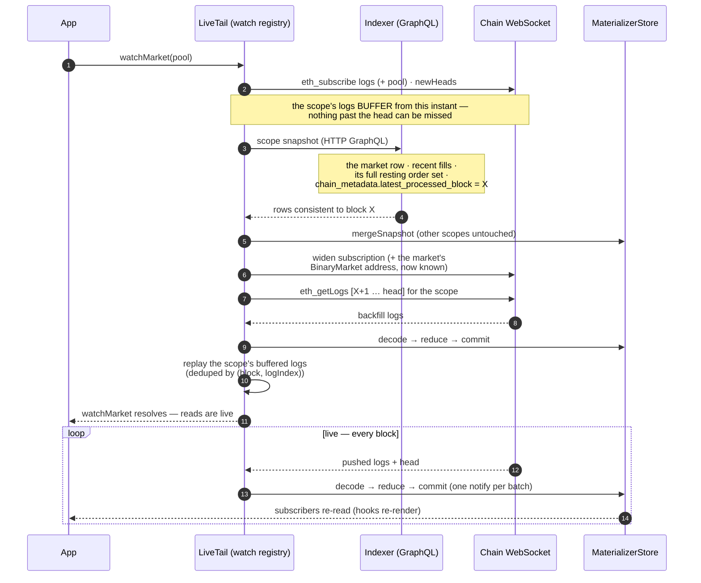
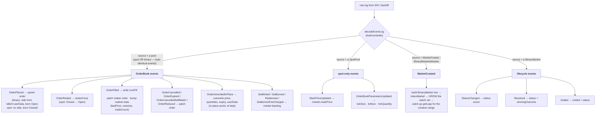
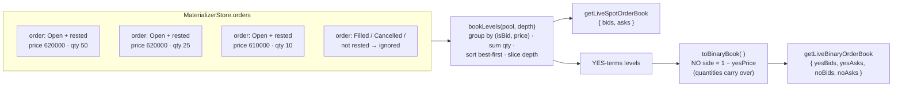
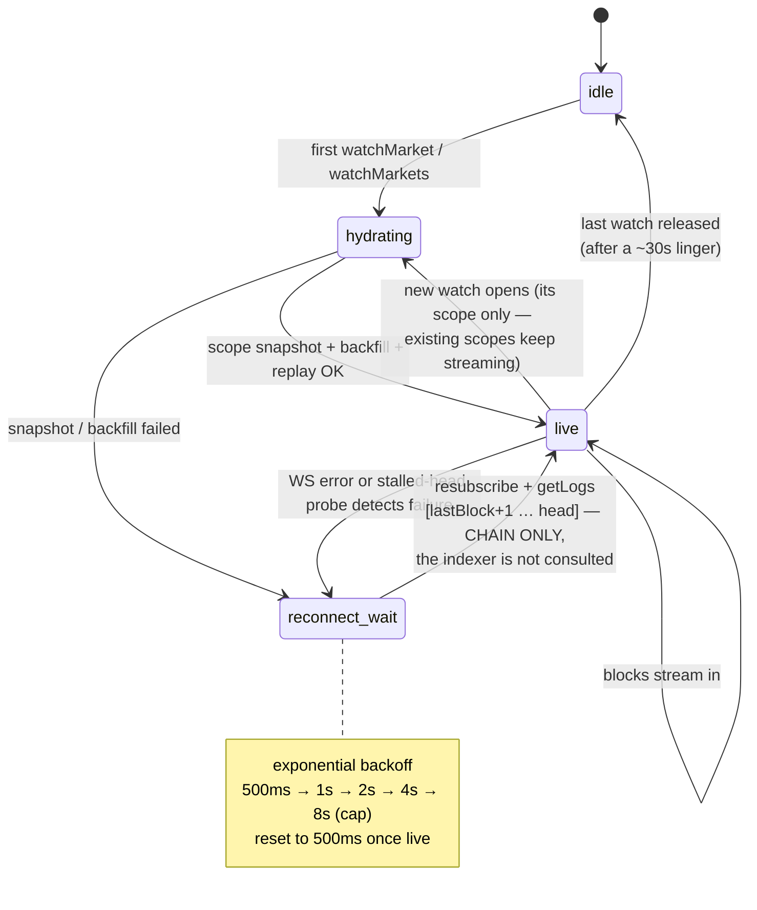

# Architecture

The SDK connects a configured `SomniaMarkets` owner to the main indexer, chain RPC, and a separate price-feed service. This page explains where live state comes from and which resources each capability uses.

Market watches hydrate indexed snapshots and then apply chain events locally. This keeps repeated store reads synchronous, while startup, recovery, historical reads, and price feeds still have network costs. Watches limit materialization work to the scopes the application uses.

- [System overview](#system-overview)
- [The client](#the-client)
- [Watches: the snapshot seam + chain materialization](#watches)
- [Event routing and the reducer](#event-routing-and-the-reducer)
- [The local order book](#the-local-order-book)
- [Connection lifecycle](#connection-lifecycle)
- [The write path](#the-write-path)
- [Choosing a read](#choosing-a-read)

## System overview

The exchange owns its `SomniaMarketsClient`. The main Envio/Hasura indexer supplies historical reads and market/user snapshots over HTTP GraphQL. The engine's lazy chain WebSocket carries its chain reads, log/head subscriptions, backfills, and sends.

Price feeds use a separate Hasura service over HTTP and one shared Hasura socket per client and endpoint. Watches that start together hydrate in batched snapshot requests. Their `PriceStore` is separate from the market `MaterializerStore`. A subscribed network tape owns another chain socket. These capabilities do not share one universal realtime connection.



Key properties:

- **Scoped.** Live materialization is opt-in per market via ref-counted
  watches. Cost — snapshot size, subscription filter width, event volume,
  reducer work — scales with what you watch, not with the protocol.
- **One engine per chain, one exchange per account.** The engine tier
  (`SomniaMarketsClient`) is bound to exactly one chain: one socket, one
  indexer, one nonce lane. The exchange (`SomniaMarkets`) owns one engine per
  configured `ChainBinding`, merges reads across them, and routes each write to
  the chain its market lives on. A market is unique to one chain, so a symbol
  resolves to one `(chainId, market)` and every returned struct names its
  `chainId`.
- **Isolation.** Every exchange owns its own config, stores, watches,
  and (lazily opened) sockets. Two exchanges never share state — per-request
  watches and parallel tests all just work. Two engines inside one exchange
  never share state either: each keeps its own nonce sequence and fee envelope.
- **Shared engine chain transport.** Engine subscriptions, reads, backfills, and sends use its memoized chain transport. Parallel requests can overlap, but dependent reads, pagination, and cache misses still affect cost. Price watches and network tapes have separate sockets.
- **Indexer startup dependency.** A new market or user scope needs indexed data to hydrate. After a successful market seam, chain events update that scope and chain backfill repairs reconnect gaps. A scope that was torn down needs hydration again. One-shot history and derived reads can continue to request the indexer while watches run.

## The client



The socket opens lazily on first chain I/O, so an indexer-only client (e.g.
server-side GraphQL reads) never opens the engine chain socket. The mirror
case holds too: `indexerUrl` is optional, so a chain-only client (smart
accounts, executors, on-chain reads) constructs without one, and every indexer
read or live watch on it throws `NotConfiguredError` naming the field. An
individual chain read never makes an indexer request either way.

## Watches

A market watch materializes its scope locally: it hydrates a
consistent snapshot of that scope from Envio up to block X, then materializes
X+1.. directly from chain logs. Scopes are ref-counted (two watchers of one
pool share everything) and torn down after a short linger when the last handle
stops. The seam is gap-free and double-count-free:



`watchMarkets({ discover })` is the same seam with scope = every eligible market
— SPOT, PERP, and BINARY markets that are not finalized, at most 500 per
snapshot, with `allMarketsTruncated` set when more exist. When discovering, it also
watches the creation-event sources: the MarketCreator factory AND the
BinaryMarketsModule. `watchUser(user)` is snapshot-only
(the account's past orders/fills — it opens no subscription of
its own, and updates only from markets this client watches). Logs for a scope that is mid-hydration buffer in an inbox while other
scopes keep applying live — one scope's seam never stalls another.

Why this is safe on Somnia specifically: blocks have **instant BFT finality** —
a delivered log is final, so there is no reorg handling. The dedupe set keyed by
`(blockNumber, logIndex)` makes the buffer/backfill overlap harmless.

Somnia logs carry no timestamp, so the `newHeads` stream doubles as the
timestamp source (block number → timestamp map, pruned as the head advances).

## Event routing and the reducer

One combined ABI (`liveEventsAbi`) decodes every watched log; the reducer routes
by **event name + source address** and mutates the store exactly the way the
Envio handlers mutate Postgres (`reducer.ts` mirrors
`indexer/src/handlers/orderbook.ts` — keep them in lockstep):



Two ordering subtleties the reducer encodes:

- **`OrderFilled` fires before the taker's `OrderPlaced`** in the same tx, so
  the taker is unknown at fill time. The fill stores `takerOrder_id` /
  `makerOrder_id` foreign keys; read-time selectors back-join owner + side from
  the order map (hydrated by the snapshot's open orders and live events).
- **`MarketCreated` grows the discovery watch live.** Two creation events are
  watched. The `MarketCreator` factory rolls each series autonomously (a Somnia
  reactivity `Schedule` sub drains the due boundary's series in a gas-bounded
  loop, spilling to the next block when a batch is too large), emitting its
  13-field `MarketCreated(marketId, market, pool, yesId, noId, collateral,
asset, strike, tradingStart, expiry, oracleQuestionId, question,
intervalSec)` — the trailing `intervalSec` is the series cadence (60 / 300 /
  900 / 3600 / 14400 / 86400). The `BinaryMarketsModule` emits its own 20-field
  `MarketCreated` for EVERY market (rolled or created directly via
  `createMarket`) — the only creation event carrying the `(operatorId,
venueId)` origin attribution — so module-created markets that never pass
  through a `MarketCreator` are discovered too. When an all-markets watch with
  `discover` is active, the tail re-subscribes with the new pool + market
  addresses and sweeps the creation range with a one-shot `getLogs`, so a
  market created seconds ago is fully tailed — the indexer is never asked
  again.

## The local order book

The store _is_ the book. Every resting order is tracked through its lifecycle,
so depth is an in-memory aggregation. Reading a hydrated book costs **zero
round-trips** and reflects the events applied to that scope. Disconnection or
recovery can leave it behind the head:



This matches the on-chain `getBookLevels` exactly because binary pools keep a
_single_ book in YES terms — a NO order is expressed as `isBid`/`userData` with
a YES-terms price, which is also how orders arrive in `OrderPlaced` events. The
one-shot chain reads (`getBinaryOrderBook`/`getSpotOrderBook`) remain available as a
separate source for callers that need a fresh node read. Stake and sell quotes
also read a cached chain tick/lot grid and can resolve a missing pool through
the main indexer; see [Read tiers](reference/read-tiers.md).

Completeness note: live-witnessed orders are always present; orders that rested
_before_ the watch opened come from the scope snapshot's open-order set — and
because snapshots are per-scope, that set is the market's whole resting book,
not a global cap's share of it.

## Connection lifecycle

The following state machine describes market live-tail subscriptions. It does not describe price feeds or network tapes. Main-indexer hydration uses HTTP. The live tail relies on pushed chain logs and heads, with chain backfill for recovery.

The live tail checks stalled heads every 15 seconds. After a stall it can request the chain head and reconnect if the subscription missed progress or the probe fails. A subscribed network tape checks for stalls every 5 seconds and has its own chain socket and recovery. These timers add background work; the SDK does not guarantee zero polling.



Reconnects never re-snapshot: the store already holds state to block L, so the
seam is simply `getLogs [L+1, head]` deduped against what's processed — chain
truth heals chain gaps. This recovery path does not request the main indexer. A new or fully released
scope still needs hydration, and one-shot indexer reads remain independent.

Price watches first hydrate over the price-feed HTTP endpoint, then subscribe
on one shared Hasura socket per client and endpoint. Watches that start together
hydrate in batched snapshot requests. They keep a separate store and connection
status.
A rejected subscription sets `getPriceStatus(asset)` to `error` and retains
stale price values; it does not fail market watches. Price scopes also linger
for about 30 seconds after the last handle stops.

`exchange.close()` releases its watches and channels and stops the client's
market and price live machinery. One-shot fetches remain usable.
`exchange.unwatchMarket(symbol)` releases one market's watch and channels and
keeps the exchange open. Its live-tail scope then lingers like any other. A network
tape returned by `createNetworkTape` is caller-owned. Release each subscription
with its returned unsubscribe function; the last release closes the tape socket.
Its lifecycle is separate from the exchange watches.

## The write path

The writer uses fixed gas limits. A sync send returns its receipt in one request.
Fallback and wallet confirmations use heads plus a one-second idle probe, with
a 60-second total deadline. Owner cancellation stops these waits. A missing
receipt remains a hash-bearing unknown outcome; check the hash before retrying.

```mermaid
sequenceDiagram
    autonumber
    participant Bot as Caller
    participant T as Trader (trade.ts)
    participant WS as Chain WebSocket

    rect rgb(235, 245, 235)
    Note over Bot,WS: LOCAL SIGNER (privateKey / account) — the fast path
    Bot->>T: placeOrder({pool, side, price, quantity})
    Note over T: resolve funding requirements<br/>uncached ERC-20 approvals may read + send;<br/>native spot sells read the current vault shortfall
    Note over T: reconcile pending nonce;<br/>serialize nonce consumption, signing,<br/>and broadcast acceptance;<br/>use fixed fees + fixed gas ceiling
    T->>WS: eth_sendRawTransactionSync(signedTx)
    Note over WS: node executes, blocks server-side<br/>until the receipt exists
    WS-->>T: receipt WITH logs
    Note over T: decode OrderPlaced → orderId<br/>decode OrderFilled → fills[]
    T-->>Bot: { hash, receipt, orderId, fills }
    end

    rect rgb(240, 240, 250)
    Note over Bot,WS: BROWSER SIGNER (injected walletClient)
    Bot->>T: placeOrder(…)
    T->>WS: eth_sendTransaction (wallet signs, fixed fees pinned)
    WS-->>T: tx hash
    T->>WS: getTransactionReceipt (immediate check)
    Note over T,WS: on miss: eth_subscribe newHeads —<br/>re-check on each pushed head, first hit wins.<br/>Idle probe after 1 s; total deadline 60 s.<br/>Failure retains the transaction hash.
    WS-->>T: receipt
    T-->>Bot: { hash, receipt, orderId, fills }
    end
```

An uncached (token, spender) pair does one `allowance` read. A short allowance
causes one `approve(maxUint256)` transaction and then enters the cache. An
existing effectively unlimited allowance also enters the cache. A finite
allowance remains uncached because an order can consume it. The next order then
reads the pool requirement and allowance again.

Before each local write, viem reconciles the node's pending nonce with its
in-memory offset. The trader serializes local nonce consumption, signing, and
broadcast acceptance. One failed write therefore cannot invalidate a
concurrent write's nonce reservation. A signer or broadcast failure resets the
manager only after every earlier local write has reached a terminal send result.

Measured on Somnia testnet with the `sdk-e2e` write suite (`E2E_WRITE=1`, which
writes a gitignored `latency-report.md`): `placeOrder` confirm p50 ≈ **503ms**,
within ~25ms of the raw transport floor.

### Spot funding preconditions

The approval cache records only effectively unlimited allowances. A finite
allowance is never cached, so the next order reads it again after the current
order may have consumed it. Spot orders ask the pool for its exact fee-aware
funding requirement when an approval check is needed. A native-base sell does
that read every time so it can send only the current vault shortfall.

## Choosing a read

Read selection depends on both the source and its startup state. [Read tiers](reference/read-tiers.md) contains the canonical Engine inventory, request costs, and method-specific exceptions.

| You want                                                  | Use                                                              | Source and freshness                                                                                                |
| --------------------------------------------------------- | ---------------------------------------------------------------- | ------------------------------------------------------------------------------------------------------------------- |
| A book for frequent rendering                             | `getLiveBinaryOrderBook` / `getLiveSpotOrderBook` / hooks        | Main-indexer hydration, then applied chain events. Synchronous after startup; inspect watch status during recovery. |
| Live trade tape or user orders                            | `getLive*` / hooks                                               | Market store. User hydration adds history; updates cover watched markets only.                                      |
| Market state from the node                                | `getMarketOnchain`                                               | Chain RPC at the block served by the node.                                                                          |
| Candles, portfolios, historical fills, or market activity | `getCandles` / `getPortfolio` / `getFills` / `getMarketActivity` | Main indexer; delay is variable.                                                                                    |
| A market list without watches                             | `listMarkets` / `listBinaryMarkets`                              | Main indexer; indexed rows can lag discovery.                                                                       |
| Raw balances or wiring                                    | `getErc20Balance` / `getSystemInfo`                              | Chain RPC; composite reads may make multiple calls.                                                                 |
| Oracle price history or streaming prices                  | `fetchPriceHistory` / `watchPrice` / price hooks                 | Separate price-feed Hasura service and PriceStore; values can be stale during errors or disconnection.              |

Derived reads can combine sources. For example, Exchange `fetchTicker` uses cached market metadata, indexed candles, and best-effort perp chain state. Both the candle read and the perp read are contained, and `statsState` and `perpState` report which of them answered. Its timestamp is response time. Engine `getOpenPositionsWithPnL` and `getClaimable` use indexed inputs, so neither guarantees current chain state. Choose an action's inputs with these limits in mind.

React's `useIndexerQuery` invokes a caller-supplied callback on mount, owner/dependency changes, and `refetch`. It does not poll or automatically refresh on live events. The callback chooses the source; the hook does not certify freshness. It passes an abort signal and ignores superseded results, while request cancellation depends on the callback forwarding the signal.
