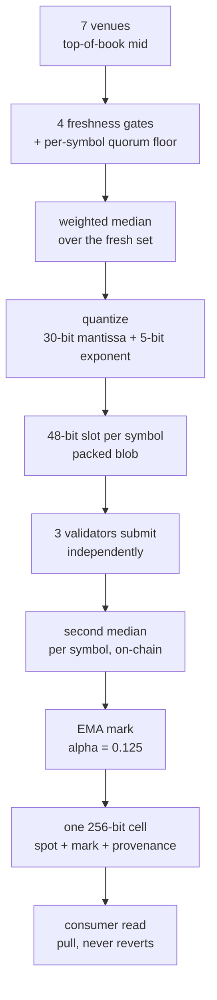

# Price feeds

A realtime index price for an asset (BTC, ETH) from the **on-chain EMA price
oracle** — streamed the same way the order books are: hydrate a snapshot to get
roughly up to speed, then tail live. It's a _read-only_ feed (an index price, not
a tradable market), so there are no orders here — just `watch`/`fetch`. The
shared client mechanics (read tiers, the reactive store, React wiring) are in
[the engine guide](./ENGINE.md); how the number itself is produced — venue
sourcing, weighted median, quantization, validator consensus, the EMA mark — is
[Methodology](#methodology) at the bottom of this page.

## The mental model

- **A separate service.** Prices come from a standalone EMA price-feed indexer
  (Hasura GraphQL), _not_ the markets indexer — its own endpoint, its own
  WebSocket. So price watches are independent of `watchMarket`: their own store,
  their own `subscribePrices` signal, their own health.
- **One endpoint, every asset.** A single endpoint (`config.priceFeed`) serves
  every tracked asset (`"BTC"`, `"ETH"`, …); callers select an asset by symbol
  (case-insensitive). Discover what's tracked with `listPriceFeeds()`. With no
  `priceFeed` configured, the price methods throw with guidance.
- **Snapshot, then live tail.** A watch first pulls an HTTP snapshot (current
  price and, when requested, recent ticks), then Hasura subscriptions stream updates. The two heal
  differently on a reconnect. The current price is a full-state subscription:
  every push carries the current row, so re-subscribing is all it needs. The tick
  tape is a stream cursored on `requestId` — it is seeded from the newest tick in
  the snapshot and advances on every push, so a reconnect resumes from the last
  tick delivered rather than replaying the window. Both are handled with backoff
  internally; neither is anything a caller has to drive.
- **One socket and batched snapshots per client.** Every watched asset on one
  endpoint shares one Hasura socket in the client. Each asset keeps its own
  current-price subscription and, when requested, tape subscription and cursor. Watches that start in the same tick (for
  example `watchPrices`, or several hooks that mount together) share snapshot
  requests of up to 10 assets each, grouped by tape demand. Each tape reader
  receives up to 200 recent ticks; latest-only readers receive none. A failed snapshot request rejects only the watches it carried. Two
  clients never share a socket.
- **Human numbers + exact raw.** Every price is a 1e18-scaled integer on the
  wire; the structs carry a display `number` (`price`, `ema`) _and_ the exact
  1e18 string in `raw` — never round-trip money through the `number`. Timestamps
  are unix **seconds** (`blockTimestamp` is chain time, monotonic — use it as a
  series x-axis; `observedAt` is the oracle's own source time and can drift).

## Configuration

```ts
import { SomniaMarkets, SOMNIA_TESTNET_PRICE_FEED } from "@somnia-chain/markets-sdk";

const exchange = new SomniaMarkets({
  indexerUrl,
  chain,
  wsRpcUrl,
  priceFeed: SOMNIA_TESTNET_PRICE_FEED, // { url, quote } - the deployed dev feed, all assets
  // or your own: priceFeed: { url: "https://…/v1/graphql", quote: "USDC" }
});
```

`priceFeed` is `{ url, wsUrl?, quote? }`; `wsUrl` is derived from `url`
(`http→ws`, `https→wss`) when omitted. Live subscriptions use the exchange's
WebSocket selection: the SDK-managed `ws` transport on Node, the platform
constructor in browsers, or `rpcWebSocketConstructor` when you set it.

**`quote` is required to watch.** The feed indexes several quotes per base
(`BTC/USDC`, `BTC/USDT`), so `base` alone is not a unique feed key. The tick tape
streams on a `requestId` cursor, and one oracle request prices every symbol in
the tick, so across quotes that cursor is not unique and a batch boundary between
two rows sharing one would advance past the second and lose the tick. Rather than
drop data quietly, `watchPrice`/`watchPrices` (and the price hooks) reject an
unpinned feed with a `NotConfiguredError` naming `config.priceFeed.quote`.

The one-shot reads (`fetchPrice`, `fetchPriceHistory`, `fetchPriceOHLCV`,
`fetchPrices`, `listPriceFeeds`) still work unpinned, where matching every quote
only double-counts a base (duplicate candle buckets, an arbitrary row per asset).
Pin it anyway unless you want that. Both shipped constants are pinned to USDC, so
anything built on `SOMNIA_TESTNET_PRICE_FEED` or `SOMNIA_MAINNET_PRICE_FEED`
needs no change.

## Reading — live

Direct `client.watchPrice` and `client.watchPrices` calls include the tick tape
by default. Pass `{ ticks: false }` for current price and metadata only. Reads
of the tick tape return an empty array until a tick reader acquires it.

Latest/info React hooks (`useLivePrice`, `useLivePriceFeedInfo`, `useWatchPrice`
and `useWatchPriceResult`) acquire no historical ticks or tape stream.
`useLivePriceTicks` acquires the tape for its asset. Adding that reader hydrates
only its asset. Removing its last reference releases the tape stream and cached
ticks after 30 seconds, while latest/info readers continue. A remount during
this linger reuses the tape and its cursor. Owner close releases everything
immediately, including pending snapshots.

Current-only and tape snapshots batch separately. A tape request failure does
not reject a simultaneous current-only acquisition. A tape upgrade also keeps
the current-price stream and its newer metadata intact.

```ts
const watch = await client.watchPrice("BTC"); // snapshot + subscribe; ref-counted

const now = client.getLivePrice("BTC"); // LivePrice | null — { price, ema, blockTimestamp, raw, … }
const tape = client.getLivePriceTicks("BTC", { limit: 120 }); // recent ticks, newest first
const info = client.getLivePriceFeedInfo("BTC"); // decimals, symbol, description, latest
const state = client.getPriceStatus("BTC"); // "unwatched" | "hydrating" | "live" | "error"

watch.stop(); // release (the last release ends this asset's subscriptions; the shared socket closes when no asset uses it)
```

**Batch variants** take/return arrays and are the ergonomic choice for a
multi-asset ticker — one watch, one read:

```ts
const handle = await client.watchPrices(["BTC", "ETH", "SOL"]); // snapshot + subscribe all; ref-counted
const rows = client.getLivePrices(["BTC", "ETH", "SOL"]); // (LivePrice | null)[], index-aligned
const status = client.getPriceStatus("BTC"); // "live" after snapshot/subscription setup
handle.stop(); // release all in one call
```

Reads are synchronous, zero-round-trip, and current to the last pushed tick;
subscribe to changes with `client.subscribePrices(listener)` (independent of the
order-book `subscribeLive`). In React the hooks auto-watch while mounted:

```tsx
import { useLivePrice, useLivePriceTicks, useWatchPrice } from "@somnia-chain/markets-sdk/react";

function Ticker() {
  const price = useLivePrice("BTC"); // updates the moment a tick lands
  const status = useWatchPrice("BTC"); // "hydrating" | "live" | "error" — render off this
  const ticks = useLivePriceTicks("BTC", 120); // for a sparkline
  if (status === "error") return <span>price feed stopped</span>;
  return <span>{price ? `$${price.price.toLocaleString()}` : "…"}</span>;
}
```

### The `"error"` state

The status is `"error"` when the price-feed server rejected or terminated the
asset's subscription. This happens on a validation failure after a schema change,
or on a permission denial. The subscription will not heal by itself, so stop the
watch and start a new one. Only the rejected asset enters `"error"`. Other assets
on the shared socket keep streaming. A dropped connection is different: every
asset on that socket becomes `stale` and heals on reconnect.

A failed stream keeps its last values. If a tape fails while latest-only
readers share the asset, the current-price stream continues. The default
`getPriceStatus` and `getPriceHealth` report the tape error. Pass `{ ticks: false }`
to either read for current-price state alone. `useWatchPrice` reads that state.
With only default/direct readers, a rejection still stops both streams.
Start a new tick reader to hydrate and subscribe the failed tape again. Each rejection is also emitted as a
`warn` event on the client's debug channel with the server payload.

## Reading — one-shot

No watch, one HTTP round-trip each — for history, charts, or a server render:

```ts
const info = await client.fetchPriceFeedInfo("BTC"); // metadata + current price
const price = await client.fetchPrice("BTC"); // LivePrice | null
const history = await client.fetchPriceHistory("BTC", { limit: 500, from, to }); // ticks, newest first
const candles = await client.fetchPriceCandles("BTC", "M1", { from, to }); // OHLC, oldest first
```

Candle resolutions are `"M1"` / `"H1"` / `"D1"` (60s / 3600s / 86400s). `count`
on a candle is the number of oracle updates in the bucket (update density), **not**
trade volume. Like every indexer read these **throw** on request failure — an
empty result means "no rows", never "request failed".

## From the exchange

The unified [`SomniaMarkets`](./EXCHANGE.md) surface exposes prices by asset
(these don't need `loadMarkets` — a price feed isn't a symbol-keyed market):

```ts
const px = await exchange.fetchPrice("BTC"); // { symbol, price, ema, timestamp, … } | null
for await (const _ of forever) {
  const tick = await exchange.watchPrice("BTC"); // resolves on each new tick
}
const ohlcv = await exchange.fetchPriceOHLCV("BTC", "1m"); // [ms, o, h, l, c, count][] — "1m"/"1h"/"1d"
```

The native `LivePrice` (raw strings + block metadata) rides on each struct's
`info`.

## Methodology

Everything above is the read surface. This section is how the number itself is
produced: exactly what is measured, what is discarded, how it is aggregated, how
it is encoded, and what a consumer is guaranteed when it reads a cell. Every
constant is the value in the shipped code (`impl v9`).

**One-line version.** A weighted median across seven venue mids, quantized to
nine significant figures, medianed again across three independent validators,
packed with its own provenance into one 256-bit storage word — every second,
paid for by the contract itself.

|                      |                                                                                                                                   |
| -------------------- | --------------------------------------------------------------------------------------------------------------------------------- |
| Cadence              | 1 s                                                                                                                               |
| Scale                | 18 decimals                                                                                                                       |
| Sources              | 7 centralised exchanges, top-of-book mid                                                                                          |
| On-chain aggregation | 3-validator subcommittee, 2-of-3 threshold                                                                                        |
| Networks             | Somnia mainnet (5031) `0x1998C88D54a240b8C671493f27f58eC416b81D7F` · testnet (50312) `0x7ccAE31E45693475be1e4BAa2360D6997eB2D32B` |



---

### 01 — Source: seven venue mids, streamed

A Go process — the **price-oracle agent** — connects to seven centralised
exchanges through a pruned fork of `ccxt`. It does not fetch on demand. One
goroutine per venue runs continuously, writing the latest quote for every
tracked pair into an in-memory store; a price request is a read of that store,
so it answers in about a millisecond with zero network I/O on the request path.

The quantity collected is the **top-of-book mid**, `(bid + ask) / 2`, spot
markets only. Four venues stream over WebSocket; three fall back to bulk REST
polling on a 1-second ticker.

| Venue   | Weight | Transport | Why                                                        |
| ------- | ------ | --------- | ---------------------------------------------------------- |
| binance | 3      | ws stream |                                                            |
| okx     | 2      | ws stream |                                                            |
| bybit   | 2      | rest poll | `wss` endpoint geoblocked from the runners' datacentre IPs |
| kucoin  | 1      | ws stream |                                                            |
| kraken  | 1      | ws stream |                                                            |
| gateio  | 1      | rest poll | stream unimplemented in the fork                           |
| mexc    | 1      | rest poll | stream connects, never delivers                            |

Total weight **11**. Weights are static configuration — **not** measured volume
or depth. They are placeholders intended to be tuned against real per-venue
liquidity. Measured source freshness: 70–220 ms on the streaming venues,
225 ms–3.3 s on REST.

> `internal/exchange/ccxt.go`, `oracle.json` · 61 tracked pairs ·
> `POLL_INTERVAL` 1 s · `PER_CALL_TIMEOUT` 8 s · reconnect backoff doubles to
> 30 s, jittered

### 02 — Admission: four gates, then a quorum floor

Staleness is the first and strictest gate. A quote that sat in the cache longer
than three seconds is not aggregated — it is not even reported as a number.

| Gate        | When        | Rule                                                                | Effect                               |
| ----------- | ----------- | ------------------------------------------------------------------- | ------------------------------------ |
| Book sanity | ingest      | both sides present, `bid > 0`, `ask > 0`, not crossed (`ask ≥ bid`) | quote discarded, never cached        |
| Spread      | ingest      | `(ask − bid) / mid ≤ 0.02`                                          | quote discarded, never cached        |
| Dwell       | aggregation | `now − UpdatedAt > STALE_AFTER (3 s)`                               | exclude, `excludedReason: "stale"`   |
| Never seen  | aggregation | configured exchange has never returned this pair                    | exclude, `excludedReason: "no-cell"` |

The first two run in `midPrices` as each venue's ticker batch is reduced to a
mid, so a bad book never reaches the store at all — there is no exclusion
reason for it, and a venue that only ever produces bad books is
indistinguishable from one that has never returned the pair. `"stale"` and
`"no-cell"` are the only two exclusion reasons that exist.

- **The spread bound is loose on purpose.** Liquid USDT pairs run around 1 bp,
  so 2% only catches a book wide enough to be a manipulation surface.
- **Dwell is measured on the agent's own ingest clock** (`now − UpdatedAt`),
  not the exchange's timestamp, so it is immune to venue clock skew. The
  comparison is strictly greater: exactly 3.000 s still counts.

**Then a per-symbol quorum floor.** With fewer than `minSources` fresh venues
the agent refuses to publish. The default floor is **3**, with a per-token
override table (`SOMI/USDC: 1`, because it does not list on three of these
venues). Below the floor the symbol's slot is written as **all zeroes** — not a
small number, not a stale number, nothing.

> `internal/store/store.go:136,198` · `internal/server/handlers.go:98–112,
406–437` · `maxMidSpreadFrac = 0.02` · `STALE_AFTER = 3s`

### 03 — Aggregation: a weighted median, not an average

Sort the fresh quotes by price. Walk the weights. The first price whose
cumulative weight crosses half the total is the index. One venue can be the
whole answer.

All seven venues fresh, total weight 11, half is 5.5:

| Venue       | Price          | Weight | Cumulative                 |
| ----------- | -------------- | ------ | -------------------------- |
| kraken      | 107,373.90     | 1      | 1                          |
| mexc        | 107,374.05     | 1      | 2                          |
| okx         | 107,374.18     | 2      | 4                          |
| **binance** | **107,374.21** | **3**  | **7** ← first to cross 5.5 |
| bybit       | 107,374.44     | 2      | 9                          |
| kucoin      | 107,374.60     | 1      | 10                         |
| gateio      | 107,375.02     | 1      | 11                         |

The index is **107,374.21**. Drop `binance` (stale) and the total falls to 8,
half is 4, and `bybit` at 107,374.44 becomes the index — a 23-cent step with no
bad data anywhere.

There is **no outlier or deviation rejection anywhere in the agent**. Robustness
comes entirely from the choice of median over mean.

### 04 — Quantization: nine significant figures in six bytes

The float becomes an 18-decimal integer, then is re-encoded as a 30-bit
mantissa and a 5-bit exponent. Everything past the ninth digit was never real.

Two lossy steps, in order:

1. **Scale-up.** The price is a `float64` the whole way through the agent, so
   multiplying by `10^18` in a `big.Float` pinned at a 53-bit mantissa
   re-rounds rather than shifting exactly. This is why BTC arrives on-chain
   looking like `63420.750000000000327680` — that tail is `float64` residue,
   not market data.
2. **Wire encoding.** Pick the smallest exponent whose mantissa still fits 30
   bits, rounding half up.

One symbol's wire slot is exactly 48 bits and exactly full:

| Field         | Bits | Range          | Example — BTC at 107,374.21               |
| ------------- | ---- | -------------- | ----------------------------------------- |
| `mantissa`    | 30   | `0 … 2^30 − 1` | `107374210`                               |
| `exp`         | 5    | `0 … 31`       | `15`, so the value is `107374210 × 10^15` |
| `sourceAgeMs` | 13   | `0 … 8191`     | `120`                                     |

### 05 — Transport: the packed blob

The contract calls `getPricesSlots(string[],uint8)` and gets back a single
`bytes` value of **exactly** `6 × nActive` bytes — no ABI element padding at
all. The symbol at active position `p` lives at bytes `[6p, 6p+6)`, big-endian.
Slots straddle 32-byte word boundaries by design.

- 30 active symbols → blob length must equal **180 bytes**, exactly.
- A **whole-zero slot** means "this validator did not price this symbol".
- A **nonzero slot with a zero mantissa** is malformed and is dropped the same
  way.
- **Any other length drops the validator entirely** — a stale cell, never a
  wrong price.

### 06 — Consensus: three validators, then a second median

Nobody trusts one agent. A subcommittee of three runs the same code in three
sandboxes against three separate caches, and the contract medians them again.

Each elected subcommittee member detects the request, runs the agent in its own
Docker sandbox, and submits its own blob on-chain. Because the agent answers
from a continuously-updated cache, the three answers are legitimately different
— which is why the platform finalises on **Threshold** consensus (2-of-3), not
Majority, which would require identical result hashes.

| Live parameter     | Value         | Consequence                                                     |
| ------------------ | ------------- | --------------------------------------------------------------- |
| `subcommitteeSize` | 3             | three independent agent runs per tick                           |
| `threshold`        | 2             | two contributors is the ordinary steady state; one is reachable |
| `consensusType`    | 1 (Threshold) | non-identical results are expected, not a fault                 |
| `timeout`          | 15 s          | must exceed 10 s — the runner cancels at `deadline − 10s`       |
| `decimals`         | 18            | the scale the agent is asked to pre-apply                       |

**Four gates on the response, before a single cell moves.**

| Rejection                          | Reason code                | Why                                                                                                                                             |
| ---------------------------------- | -------------------------- | ----------------------------------------------------------------------------------------------------------------------------------------------- |
| not in the inflight ring           | `not-inflight`             | ring lookup and consume, so a duplicate callback is idempotent                                                                                  |
| `status ≠ Success`                 | `AgentRequestFailed`       | no cells written                                                                                                                                |
| `block.timestamp − kickedAt > 3 s` | `stale-response`           | the platform's timeout upkeep can deliver a quorum-met partial as `Success` hours late; ingesting it would sawtooth the feed and poison the EMA |
| `symbolsVersion` moved             | `symbols-version-mismatch` | responses carry no symbol identity, only array position — if the symbol list changed since the kick, position `i` may be a different asset      |

Any symbol-list mutation invalidates every inflight request; the next tick
refills everything within one interval.

**The second median — per validator, per symbol.**

For each symbol the fill loop does one `calldataload` per validator, gates it,
and medians the survivors. The gate is **per-validator**, which is the whole
point: one garbage validator drops out instead of shifting the median.

| Symbol        | Validator A | Validator B  | Validator C | Cell written                       |
| ------------- | ----------- | ------------ | ----------- | ---------------------------------- |
| BTC/USDC      | 107,374.18  | 107,374.21   | 107,374.30  | 107,374.21 · vc 3                  |
| ETH/USDC      | 3,142.07    | slot = 0     | 3,142.11    | 3,142.11 · vc 2                    |
| SOL/USDC      | slot = 0    | mantissa = 0 | 184.62      | 184.62 · vc 1                      |
| FARTCOIN/USDC | slot = 0    | slot = 0     | slot = 0    | untouched — omitted from the batch |

Insertion sort, then `values[n / 2]` — the **upper** middle on even counts,
which at the ordinary 2-of-3 threshold means the higher of the two prices. On a
2-validator tick the median is not a blend; it is a pick. `vc` is
`validatorCount`, the surviving contributor count, saturating at 7, with 0
meaning _unknown_ — never "none".

### 07 — Mark price: the same number, smoothed

Mark is **not a different data source**. It is an EMA over the spot series,
computed from the previous cell, and it costs no extra storage.

Each tick the mark moves `emaAlpha = 0.125e18` — one eighth — of the way from
the previous mark toward the new spot. At the 1 s cadence that is a smoothing
horizon of τ ≈ 8 s.

**Response to a genuine move.**

After `n` ticks the fraction of a step captured is `1 − 0.875^n`. The
conventional time constant τ is where that crosses 63%, and it lands exactly
where `interval / alpha` predicts — 8 ticks:

| Ticks    | 1     | 2     | 4     | 6     | 8 (= τ) | 16    | 24    |
| -------- | ----- | ----- | ----- | ----- | ------- | ----- | ----- |
| Captured | 12.5% | 23.4% | 41.4% | 55.1% | 65.6%   | 88.2% | 95.9% |

**Alpha is per tick, not per second.** τ ≈ 8 s here, but τ ≈ 80 s in the DEX's
oracles — same `emaAlpha = 0.125e18`, copied from their production values, but
their cadence is 10 s. Rescale alpha if the cadence changes and the smoothing
horizon should stay put. `emaAlpha = 1e18` disables smoothing entirely — mark
becomes spot.

### 08 — Storage: everything in one slot

Spot, mark, timestamp, source age and provenance share a single 256-bit word.
One cold `SSTORE` per symbol per tick, one `SLOAD` to read all of it.

| Field         | Bits | Encoding, and what 0 means                                                                                                                                                                  |
| ------------- | ---- | ------------------------------------------------------------------------------------------------------------------------------------------------------------------------------------------- |
| `price`       | 86   | spot median at 18 dp. Ceiling ≈ 77 M per unit.                                                                                                                                              |
| `quality`     | 14   | packed sub-fields, below                                                                                                                                                                    |
| `mark`        | 86   | EMA mark; always between the previous mark and this spot                                                                                                                                    |
| _reserved_    | 14   |                                                                                                                                                                                             |
| `updatedAtMs` | 42   | `block.timestamp × 1000` — second-granular, shared by every symbol written in the same tick. A `maxAgeMs` bound below the tick cadence is not meaningful. Good to year 2109.                |
| `sourceAgeMs` | 14   | a delta below `updatedAtMs`, not an absolute stamp — capped at 16.383 s. The top value is the sentinel and reads back as `0 = unknown`, never "current", so a real age clamps one below it. |

The 14-bit `quality` field expands to:

| Sub-field            | Bits | Meaning                                                                                                                                             |
| -------------------- | ---- | --------------------------------------------------------------------------------------------------------------------------------------------------- |
| `validatorCount`     | 3    | contributors to the median, saturating at 7. `0 = unknown` (a cell written before the field shipped), never "none" — a written cell always had ≥ 1. |
| `medianControlCount` | 3    | reserved. Always reads `0`. No room on the wire. Do not branch on it.                                                                               |
| `flags`              | 2    | bit 0 `FLAG_MARK_RESYNCED`; bit 1 `FLAG_DEVIATION` reserved and never set.                                                                          |
| _reserved_           | 6    |                                                                                                                                                     |

Removing a symbol deletes its cell. **Indices are append-only and never
reused**, so an on-chain consumer can resolve index → symbol once off
`SymbolAdded` and read by index forever — one `SLOAD` cheaper than the
string-keyed path, with no risk that a removal elsewhere silently shifts the
mapping.

> `contracts/feed/lib/PriceCell.sol` · `lib/FeedHealth.sol` ·
> `lib/ActiveIndexSet.sol`

### 09 — Consumption: pull, and decide staleness yourself

Reads never revert. Staleness is the caller's decision, always — the feed will
not decide on your behalf what is too old.

| Interface             | Keyed by         | Gives you                                            |
| --------------------- | ---------------- | ---------------------------------------------------- |
| `IPriceFeed`          | symbol string    | spot, cell age, source age, tracked-symbol registry  |
| `IMarkPriceFeed`      | symbol string    | EMA mark (separate so `IPriceFeed`'s id never moved) |
| `IIndexedPriceFeed`   | stable `uint256` | the same data, one `SLOAD` cheaper                   |
| `IQualifiedPriceFeed` | either           | quorum, flags, feed liveness, and the safe reads     |

**Off-chain: one batched event, and history.**

Each tick emits a single
`PricesUpdated(requestId, updatedAtMs, indices[], prices[], marks[], sourceUpdatedAtsMs[], resyncedBits)`
— one event for the whole batch, carrying only stable indices. An Envio + Hasura
stack indexes it into `Feed` (latest per symbol, a Chainlink-ish
`latestRoundData` analogue), `PricePoint` (the per-tick firehose), `Candle`
(OHLC at M1 / H1 / D1) and `Symbol` (the index → pair registry). That GraphQL
surface is what the price methods above read.

> **GraphQL is for humans, not for settlement.** Testnet only, and observability
> only. It lags the chain, can be resynced, and is not part of the support
> contract. Never settle, liquidate, or price anything off it.

**End-to-end latency.**

| Leg                                                  | Time        |
| ---------------------------------------------------- | ----------- |
| 1 — exchange → agent                                 | ~0.1 s (ws) |
| 2 + 4 + 5 — cache dwell + kick→response + cell write | ~0.8 s      |
| 6 — wait for your next read                          | 0–~1 s      |

Measured on testnet over 150 consecutive BTC/USDC ticks: cell cadence median
1 s (max 2 s), kick→cell median ~0.8 s ≈ 7 blocks at ~116 ms. A consumer acts on
a price 1–2 s old; at the instant of the cell write it is ~0.9 s. The dominant
and most actionable leg is kick→cell. REST-only venues are the other lever —
they inflate leg 1 and can leave source age unmeasurable entirely.

---

### Sources

Contracts and scheduler:

- `smart-contracts/contracts/feed/PriceFeedScheduler.sol`
- `smart-contracts/contracts/feed/lib/PriceCell.sol`
- `smart-contracts/contracts/feed/lib/SlotResponse.sol`
- `smart-contracts/contracts/feed/lib/FeedHealth.sol`
- `smart-contracts/docs/price-feed-scheduler.md`,
  `price-feed-latency.md`, `price-feed-design-decisions.md`
- `smart-contracts/script/config/feed-testnet-development.json`
- `docs/price-feed-integration.md`
- `price-feed/indexer/schema.graphql`

Agent:

- `somnia-agents/agents/price-oracle/internal/store/store.go`
- `somnia-agents/agents/price-oracle/internal/server/handlers.go`
- `somnia-agents/agents/price-oracle/internal/exchange/ccxt.go`
- `somnia-agents/agents/price-oracle/oracle.json`, `agent.json`

## Delivery state and acquisition errors

The price service is separate from the main indexer. Its results do not carry main-indexer watermarks. `hydrated` means the HTTP snapshot completed. `streaming` requires valid initial results from every acquired stream. Current-only health requires only current-price delivery. Empty arrays confirm delivery without creating a price. A connection acknowledgement alone does not establish streaming.

`stale` means known delivery loss. It does not infer an expected oracle tick frequency. The asset retains its last values while reconnecting, and every acquired stream must deliver again before `streaming` returns. `error` means hydration failed or a subscription was rejected. Each asset reports its own state, so a healthy sibling cannot conceal a stale one.

Existing `getPriceStatus` and `useWatchPrice` keep `unwatched | hydrating | live | error`. The legacy `live` state means snapshot/subscription setup succeeded; it does not confirm operation delivery. A disconnect does not change that legacy state.

Opt into `client.getPriceHealth(asset)` or `client.listPriceHealth()` for the precise states above. They share the existing price watches and `subscribePrices` notifications. No extra socket opens. Automatic hooks continue reporting acquisition failures through the debug/console warning channel. Use `useWatchMarketResult`, `useWatchUserResult`, or `useWatchPriceResult` for typed inline acquisition UI. Effects ignore superseded failures and release handles acquired after unmount.
