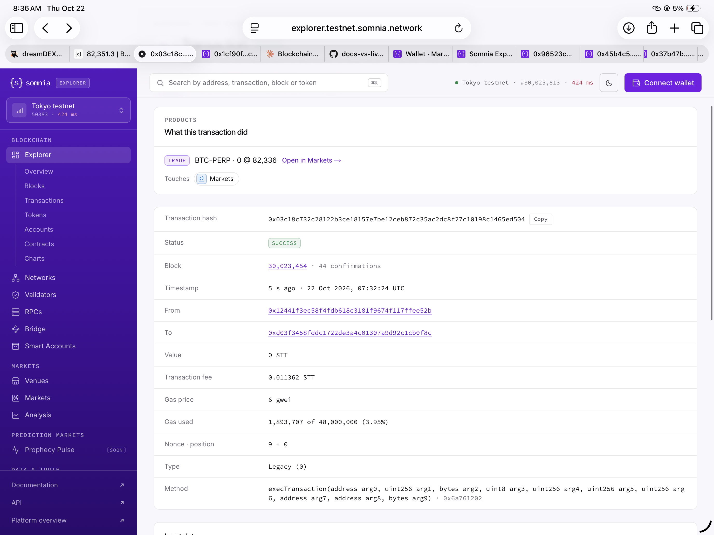

# Explorer trade card shows size "0" for perps markets whose base asset is not 18 decimals (BTC-PERP, ZEC-PERP), and does not label the ZEC-PERP pool
Severity: normal
Area: app

## Steps to reproduce
1. Open an ETH-PERP trade (base decimals 18): https://explorer.testnet.somnia.network/tokyo/tx/0x96523c38c62eec6309182a56ddaa3f003b5123ccdaefb3da7920b8369fe1d7e5
   The "What this transaction did" card reads `TRADE  ETH-PERP · 0.0081 @ 2,474.67` (the order was 0.0081 ETH).
2. Open a BTC-PERP trade (base decimals 8) that opened 0.00024 BTC: https://explorer.testnet.somnia.network/tokyo/tx/0x1cf90f365b0fb239dec547c729c620cc9ef04dd1703d26287914fcf12b8ac9a8
   The card reads `TRADE  BTC-PERP · 0 @ 82,336.7`.
3. Open the BTC-PERP close sent from the app a minute later: https://explorer.testnet.somnia.network/tokyo/tx/0x03c18c732c28122b3ce18157e7be12ceb872c35ac2dc8f27c10198c1465ed504
   The card reads `TRADE  BTC-PERP · 0 @ 82,336`.
4. Open two ZEC-PERP trades from the app (base decimals 8): https://explorer.testnet.somnia.network/tokyo/tx/0x45b4c5cd9685d4721f5878a0b70d9809fcc11ac8720309f6015c4a9d10d13a2d and https://explorer.testnet.somnia.network/tokyo/tx/0x37b47b06cee43d205559ca27aefba9ccf2d0590cbaf8ae5bf33b563dcf513293
   The cards read `TRADE  0x2a73…f050 · 0 @ 1,304.79` and `… · 0 @ 1,305.77`.

## Expected
The size on the card is the traded amount, for example `BTC-PERP · 0.00024 @ 82,336.7`, and the pool `0x2a73129F26917124bd2A47a9B355C395C537F050` is labelled with its market name, as the ETH-PERP and BTC-PERP pools are.

## Actual
1. The size shows as `0` on every trade in a market whose base asset has fewer than 18 decimals, so far BTC-PERP (8) and ZEC-PERP (8). ETH-PERP (18) shows correctly. A likely cause: the explorer divides the raw size by 18 decimals for every market. 0.00024 BTC is 24,000 raw units, which is 0.000000000000024000 at 18 decimals and rounds to 0. The prices are right.
2. The ZEC-PERP pool `0x2a73…f050` has no market label: the card shows the shortened pool address instead of the market name, and the pool argument in the call data has no label, while `0x4181dd08e73bbcdd1ba3e615a18f6abd941b94c0` is labelled BTC-PERP and `0xD6Cb1DD58580B84D76068aC21594219ce03aeddf` is labelled ETH-PERP.

The live market list shows base decimals of 6, 7, 8, 9, 18 and 24 across the 21 perps markets, so most markets other than 18-decimal ones are probably affected too. I confirmed it on BTC-PERP and ZEC-PERP only.

## Evidence
Cards:     
All five transactions have status SUCCESS. Order size from the bot log for the BTC trade: "placed open long 0.00024 BTC @ 82506.8 | filled 0.00024 | order 8817543667233172607686". For ZEC: "placed open long 0.015 ZEC @ 1329.943 | filled 0.015".
Base decimals per market (live SDK market list, 2026-10-22): BTC 8, ETH 18, HYPE 6, SOL 9, XRP 6, ADA 6, AVAX 18, BNB 18, DOGE 8, LINK 18, NEAR 24, SUI 9, XLM 7, 1000PEPE 18, LIT 18, PUMP 6, TAO 9, VVV 18, WLD 18, ZEC 8, ZRO 18.

## Environment
Somnia Tokyo testnet explorer, Safari on iPad, 2026-10-22. Wallet address: 0xD03f3458FdDC1722dE3a4c01307A9D92c1cB0F8C
